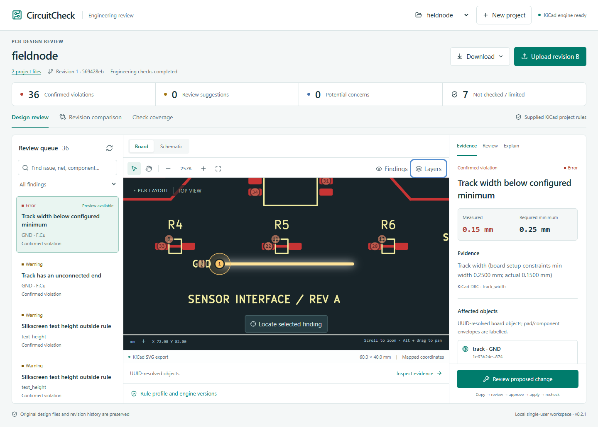

# Circuit Check

Circuit Check combines a local circuit review app, website preview and browser extension. It explains supported wiring and PCB design issues, reconstructs schematics from captured connections, and offers an optional Groq assistant grounded in the selected circuit and its KiCad reports.

## Downloads and installation

- [Download the complete local app](downloads/CircuitCheck-complete-v0.2.1-extension-v0.6.4.zip) — includes the built interface, Python backend, extension source and extension ZIP. Extract it, open `CircuitCheck`, run **Setup CircuitCheck.cmd**, then **Start CircuitCheck.cmd**. Install Python and KiCad separately. The app opens at `http://127.0.0.1:8000/`.
- [Download browser extension v0.6.4](public/downloads/Circuit-Check-Multi-platform-v0.6.4.zip) — extract, open `chrome://extensions` or `edge://extensions`, enable Developer mode, choose **Load unpacked**, and select the extracted folder containing `manifest.json`.
- [Browser extension source and simulator guide](browser-extension/README.md).
- [Release notes](RELEASE_NOTES.md).

Tinkercad and Wokwi have live project readers. Other supported tools use compatible-site readers or exported circuit files; see the extension guide for SimDuino, Falstad/CircuitJS, CircuitLab, SimulIDE, Proteus and LTspice support and limits. Desktop apps require supported exports.

The **Circuit assistant** tab uses actual captured components, pin/net data, project rules, KiCad findings and check coverage. Connect your own Groq key in the local form; without a key it provides clearly labelled evidence-only answers. Account rate limits apply. Automatic schematics preserve disconnected pins and missing wiring. No overall health score is calculated.

## Repository history

This repository contains the updated software from the local Circuit Check workspace. The [previous repository](https://github.com/shubhanshuambashta-code/circuitcheck) remains available for reference. This is a source snapshot, not a merge of the previous repository's Git history.

## Project layout

| Folder | Contents |
|---|---|
| `src/` | Shared React website and local app interface |
| `backend/` | FastAPI API, native KiCad worker and circuit assistant |
| `browser-extension/` | Complete extension source, tests and usage guide |
| `public/downloads/` | Installable extension ZIP served by the app and preview |
| `downloads/` | Complete local app ZIP |
| `fixtures/`, `tests/`, `e2e/` | Synthetic circuits and verification code |

Original design files, saved projects, API keys, databases and machine-specific runtime settings are excluded from this repository.


Review a KiCad PCB project before sending it for fabrication. CircuitCheck runs native KiCad checks, shows each reported problem on the board, and lets you preview a supported correction in a separate copy before applying it and checking again.



## Start on Windows

Extract the ZIP completely. For a new installation, double-click **Setup CircuitCheck.cmd** once; then double-click **Start CircuitCheck.cmd** to run it in the background. You can close the launcher window; use **Stop CircuitCheck.cmd** to stop the server. The launcher registers a background Windows task for the current user. While you are signed in, a one-minute recovery trigger restarts the server after an unexpected exit. Stop CircuitCheck.cmd disables this recovery and stops the app process tree; Start CircuitCheck.cmd enables it again. The complete ZIP includes a production frontend and does not require Node.js during setup. A source checkout needs Node.js to build the frontend. Python and KiCad remain runtime prerequisites. This configured computer can reuse its existing installation through the private `data/runtime.json` file. Reopening the launcher reuses an already running matching local server. While enabled, the task can recover after signing into Windows. Use the launcher to open the browser or restart after an intentional Stop. Background service logs are retained under the configured data directory in `logs/supervisor.log`, `logs/api.log` and `logs/worker.log`. Direct `scripts/start.ps1` remains available for foreground diagnostics.

The optional GitHub Pages site is an interactive recorded example. Enable GitHub Pages with GitHub Actions, then run the manual Pages workflow. Live circuit uploads, KiCad checks and Groq configuration run in the local app.

## Engineering review v0.2.1

- The local app and public website share the same review interface. The website is an **interactive recorded example**, clearly labelled; live uploads and edits require the local engine.
- Click a finding to zoom to UUID-resolved tracks, pads, components or reported locations. Pads/components use explicit object envelopes. Net highlighting follows stored net assignments. Unavailable mappings are labelled and never guessed; schematic findings cross-probe only unambiguous matching component references/pads.
- Confirmed native rule violations, evidence-supported review suggestions and unconfirmed potential concerns are separate categories. AI explains selected evidence and does not establish engineering violations.
- Coverage lists evaluated checks, findings, ignored rules, failures, missing dependencies and checks that were not performed. There is no overall safety score. Rule/profile fingerprints, source hashes, KiCad, normalizer, geometry and explanation-engine versions are visible.
- **Upload revision B** into the current project to compare resolved, remaining and new findings, moved/changed components and physical routing/pad-net changes. Review comments and accepted exceptions persist. Exceptions retain the native finding and require re-review when their evidence or scope changes.
- Rule/profile/engine/coverage changes or unstable object identities prevent a disappearance from being labelled a verified fix. UUID rewrites appear as added/removed objects. Physical routing comparison does not infer circuit intent or establish logical connectivity equivalence.
- Select the `PCBWAY-STANDARD-BASELINE` published snapshot, import a numeric JSON profile, enter custom minimum dimensions, or include native `.kicad_dru` rules in the project ZIP. Manufacturer order references are stored as metadata; unknown codes do not fetch or invent private order constraints. Presets are scoped published minima, not full manufacturer approval.
- Supported track-width fixes follow **copy → native recheck → review → explicit approval → apply → fresh recheck → download**. Other findings show a specific manual action in KiCad and can be re-uploaded as a revision.
- Readable HTML and JSON reports retain coverage, provenance and review decisions; JSON also records explanation history and the actual explanation-model identifier returned by the provider when available.

JSON fabrication profile example (all dimensions in mm):

```json
{"code":"CUSTOM","name":"My fabrication specification","version":"1","source":"Approved drawing / quote reference","constraints":{"track_width":0.2,"clearance":0.2,"hole_size":0.3}}
```

Supported numeric constraints: `track_width`, `clearance`, `hole_size`, `annular_width`, `edge_clearance`. A separate native KiCad DRC pass evaluates these in a disposable copy while preserving the original project rules and original files.

## What it does

- Accepts a complete KiCad project ZIP or multiple native project files.
- Shows actual engine findings, reported locations, rule evidence and check coverage.
- Previews a correction for a supported straight-track width violation, then reruns native checks before apply is available.
- Preserves originals and revision history, with comparison, restore and native project export.
- Includes downloadable synthetic test projects with known expected results at `/test-files/`.
- Works without an AI key. Optional model explanations are separate from the native check results.

This is a local, single-user application. Switch between Board and Schematic to inspect native exports, select hierarchical sheets and navigate electrical-rule findings. ERC pins use native reported coordinates, symbols use labelled anchors and source wires retain their UUID paths. Revision comparison supports both board and schematic views. General schematic editing and logical net tracing remain in KiCad. The included Fieldnode design is an original synthetic test fixture, not a validated functional circuit.

## Tech stack

| Layer | Technology |
|---|---|
| Interface | React, TypeScript, Vite, Tailwind CSS |
| API | Python, FastAPI, Uvicorn |
| Analysis | Separate Python worker calling native KiCad CLI |
| Local storage | SQLite and project files |
| Tests | pytest and Playwright |

## Quick start

Clone or download this repository, open a terminal in its root, then follow the setup below. KiCad is installed separately; it is not bundled in the repository.

### Install and run

Tested host: Windows x64, Python **3.14.6**, Node **24.21.0**, npm **11.19.0**, KiCad **10.0.7**. Direct Python dependencies are pinned in `requirements.txt`; the tested full dependency set is in `requirements.lock.txt`. Frontend dependencies are pinned in `package.json` and `package-lock.json`.

1. Install Python 3.12 or later and Node 22.12 or later. Only the versions above were executed on this host.
2. Install **KiCad 10.0.7** from [the official Windows download page](https://www.kicad.org/download/windows/) or [official Linux instructions](https://www.kicad.org/download/linux/). The recorded website preview needs no local KiCad; checking your own uploaded circuit requires the local engine.
3. In this folder, run:

```powershell
.\scripts\setup.ps1
```

4. If KiCad is not found automatically, copy `.env.example` to `.env` and set its literal `KICAD_CLI` path. Leave `AI_API_KEY` empty for deterministic explanations.
5. Run `.\scripts\start.ps1`.

For Linux/macOS:

```sh
sh scripts/setup.sh
# If needed: export KICAD_CLI=/absolute/path/to/kicad-cli
.venv/bin/python scripts/start.py --open
```

Linux/macOS startup scripts are supplied but were not executed here. Do not copy the Windows CLI path from `.env.example` on Linux.

## GitHub Pages preview

The published site provides an interactive replay of two real native KiCad runs on an original synthetic fixture, with object highlighting, revision comparisons, coverage, review history and downloadable native project versions. Its persistent banner identifies recorded results. GitHub Pages cannot execute FastAPI, SQLite jobs or native KiCad; live uploads, notes and approved edits require the local application.

In **Settings > Pages**, set **Source** to **GitHub Actions**. `.github/workflows/pages.yml` installs locked frontend dependencies, runs `npm run build:pages`, and deploys only `dist-pages/`. The Pages build uses `/circuit-check/` as its base; `npm run build` still produces the working local application in `dist/` with `/` as its base. Do not publish the source folder directly: browsers cannot execute the TypeScript entry point without Vite's build step.

To preview the Pages build locally, run `npm run build:pages`, then `npm run preview -- --mode pages --outDir dist-pages --port 4173`. Visit `http://127.0.0.1:4173/circuit-check/`. A full public analysis deployment would additionally require a server with KiCad, worker processes, persistent storage, authentication, project ownership checks and isolated execution; none is provisioned by this workflow.

## Development and tests

The API and worker must both run. From this folder, with the Python environment activated:

```sh
python -m uvicorn backend.main:app --host 127.0.0.1 --port 8000
python -m backend.worker
npm run dev
```

Vite serves port 5173 and proxies `/api` to port 8000. For production local use, `npm run build` produces `dist/`, which FastAPI serves directly. Interactive API documentation is at `/docs`.

```sh
python -m pytest -q
npm run build
npm run test:e2e
```

Browser tests use an installed Chrome by default. Set `PW_CHANNEL=msedge` to use Edge, or install the matching Playwright Chromium and use the appropriate channel configuration. Set `PW_BASE_URL=http://127.0.0.1:5173` when testing the Vite server. Run the API and worker before browser tests. They intentionally create synthetic projects in the configured data directory; use a disposable `CIRCUITCHECK_DATA` directory for an isolated test installation.

Fixtures are original, redistributable CC0 content. `scripts/generate_fixtures.py` regenerates them with deterministic UUIDs. Tests use real KiCad for clean boards, deliberate DRC/ERC findings, SVG coordinate checks, hierarchical schematics, custom rules, missing libraries, repair validation, comparisons and downloads. Engine tests skip explicitly if KiCad is absent; a skipped integration is not a pass.

See `VERIFICATION.md` for executed checks, results and remaining limitations. Rendered examples are in `screenshots/`.

## Review workflow

### Try it without your own design files

Open `http://127.0.0.1:8000/test-files/` while CircuitCheck is running. This page provides downloadable native KiCad ZIPs, literal expected results, original engine reports and a step-by-step repair test. Upload each ZIP unchanged. The deliberate width problem reports 1 error and 1 unconnected-end warning; the corrected width reports 0 errors and the same warning; the empty board outline reports no DRC findings. These are synthetic fixtures, and no schematic is checked in those three cases. The downloadable cases were also executed through the live upload/worker pipeline after packaging.

1. Upload a complete project ZIP, or select multiple native files together. ZIPs preserve hierarchy and directory structure. Originals are stored separately.
2. Select a root only when multiple independent candidate roots exist. The worker runs supported checks outside the upload request.
3. Select a finding in the table or viewer. Reported coordinates, objects, rules and literal measurements appear in the details panel. Location is left unavailable when the engine does not provide one.
4. For a supported track-width violation, select **Preview change**. Only the exact segment UUID's width atom is changed in a new candidate copy. The engine reopens it through SVG export and reruns DRC before apply is available.
5. Review resolved, remaining and new findings. **Apply change & recheck** creates the current revision and runs fresh checks. A saved file or a lower total finding count does not establish a verified resolution.
6. Use Revisions to compare or restore the parent revision. Export originals, the current native project ZIP, or the normalized JSON report. Original engine JSON, logs, SVG exports and the schematic netlist remain available through project-scoped artifact routes.

The viewer uses native full-page, scale-1, unmirrored SVG exports. Mapping comes from millimetre dimensions and `viewBox`, preserving KiCad's top-left origin (X right, Y down). The native fixture endpoint-to-SVG transformation is integration-tested. Fitted/cropped SVGs and unknown coordinate mappings are not assumed. PCB layers are exported individually with identical validated transforms. Markers highlight reported positions, not inferred minimum-distance collision points. SVG element IDs are never treated as CAD object IDs.

Keyboard: Ctrl/Command+O opens upload; F fits the view; Alt+drag pans; Escape closes dialogs. Narrow screens use Design / Findings / Details tabs. Dialogs use native modal focus trapping. Reduced-motion preferences are respected.

## Capability matrix

| Input | Read | Preview | Electrical / connectivity | Geometry / manufacturing | Editing | Native export | Conversion |
|---|---|---|---|---|---|---|---|
| `.kicad_pcb` | Native | SVG layers | PCB connectivity DRC; parity with a complete matching schematic | Native project DRC | One selected straight segment's width | Revised board in project ZIP | None |
| `.kicad_sch` + internal hierarchy | Native | SVG sheets | ERC + XML netlist | Not applicable | Unavailable | Original schematic preserved | None |
| `.kicad_pro`, `.kicad_dru`, library tables and bundled native libraries | Project dependencies | Through the design | Rules and dependencies used by native checks | Native rules | Settings/rules never weakened | Preserved | None |
| Project ZIP | Validated extraction | Contained native designs | As above | As above | As above | Directory structure preserved | None |
| STEP/WRL accompanying a project; PDFs/images | Stored reference/dependency files | Not analyzed or displayed | Not checked | Not checked | Unavailable | Preserved in ZIP | None |
| EasyEDA, EAGLE, Altium, Gerber/Excellon, standalone STEP/IGES, DXF, STL | Unsupported | Unsupported | Not checked | Not checked | Unsupported | Unsupported | None |

The adapter boundary is `backend/engine.py`, with independent capabilities in `/api/capabilities`. Future formats require verified parsers/converters, fixtures and their own analysis implementation before becoming available. KiCad's broader import options are intentionally not advertised as CircuitCheck support.

A project settings file alone cannot be analyzed. Photographs, PDFs, mechanical models and fabrication plots do not establish authoritative electrical connectivity. ERC/DRC do not establish component ratings, current capacity, physical soldering quality, or functional/safety performance.

## Analysis semantics

- CLI command help is probed before using version-dependent flags. Tested pin: **10.0.7**; other 10.0 patch versions are accepted but unverified. Other major versions fail explicitly.
- Native JSON reports retain severity settings and exclusions. Exit 5 means reported violations, not an execution failure. Other nonzero exits, timeouts and malformed reports fail the affected check.
- Board DRC refills zones in memory in a disposable working copy with `--refill-zones`, without `--save-board`. SVG exports use `--check-zones`. Existing saved fills and originals are not rewritten.
- Job states: queued, running, completed, partial, failed. Completed means the applicable checks finished; absent design types remain visibly **Not checked**. Missing settings/libraries mark analysis partial. A hierarchy missing required subsheets skips ERC and cannot become a clean result.
- A native engine can sometimes read an unexpected file version. Compatibility is established by actual loading/checking/exporting; unsupported syntax fails with retained logs. CircuitCheck does not claim all historical or future native versions are verified.
- A missing custom-rule file cannot always be distinguished from a project that never had one. The upload records that uncertainty instead of inventing rules. Bundle the complete project to establish rule completeness.
- Analysis caches include content, rules, engine version, selected root and analysis options. Edits invalidate the cache. Apply forces a fresh run. Each original engine report, tool version, revision hash, rules fingerprint, logs and check coverage is retained.
- Stable finding IDs derive from engine, root file, rule, sheet and affected UUIDs. This supports comparisons for unchanged objects; rewriting UUIDs in an external editor appears as removed/new findings. Different reports referring to the same rule and exact UUID set may be coalesced; original reports preserve the complete engine output.
- Core checks do not require AI credentials. Optional AI never writes files or chooses executable operations. Free-form prose cannot be proven true automatically: schemas, known-reference checks and a conservative numerical guard reject unsupported output, and model explanations are labelled for review against evidence.

## Optional assistant

Use **Circuit assistant → Connect Groq** in the local app, or configure `GROQ_API_KEY` server-side. The legacy `AI_API_KEY`, `AI_BASE_URL` and `AI_MODEL` settings remain available for a compatible backend that supports strict JSON-schema output. See the full circuit-aware assistant section below for context selection, storage and limitations.

A bounded selection of actual components, pin/net connections, project rules, KiCad reports, coverage, the question and matching prior conversation is sent to the configured provider. The context inspector shows included evidence and omissions. Credentials are used only to authenticate the provider request. Network/provider failures or rejected responses fall back to clearly labelled evidence-only explanations. No live model completion was executed on this host because no key was configured; provider behavior was tested with controlled responses.

## Storage, limits and deployment

`data/circuitcheck.sqlite3` stores projects, immutable revisions, jobs, normalized findings/results and repair previews. `data/projects/<uuid>/original/` preserves uploads; `revisions/<uuid>/source/` holds immutable native files; `artifacts/` holds reports and previews. `LocalStorage` is a storage protocol implementation and `db.py` is a small data-access layer. PostgreSQL/object storage would require a new implementation; they are not included.

Uploads are limited to 25 MB compressed, 100 MB expanded, 500 entries and 12 archive path levels. Traversal, absolute/drive/UNC names, links, platform device names, collisions, encrypted entries and nested archives are rejected. Only allowed data files are accepted. External library URIs are blocked; bundle libraries using `${KIPRJMOD}`. Uploaded scripts are never executed and dependencies are never downloaded automatically. SVG is parsed with defusedxml and reduced to a safe drawing subset, then loaded as an image with a restrictive response CSP.

Only one native job runs at a time across workers; the queue is bounded. CLI calls use argument arrays, a timeout, stripped credential variables and captured output. Windows Job Objects cap each engine process at 1.5 GiB and terminate its descendants on close. Unix processes have CPU/address-space/output-file limits. A failure to establish Windows limits fails the engine explicitly. A stale running job fails after 10 minutes without a stage update; rerun it after restarting the worker.

**Local-only deployment:** API binding is loopback, accepted Host/Origin values are local, and mutations require a custom header. This is not multi-user authentication or an operating-system security sandbox. Native local jobs still run with the launching user's OS access. Use a dedicated OS account/container for untrusted projects. This build must not be exposed publicly without authentication, ownership checks and protected per-user downloads.

Docker/Compose files are supplied with loopback port binding, a non-root user, resource caps, dropped capabilities, read-only root filesystems and a network-disabled worker. Build/run:

```sh
docker compose up --build
```

**Docker was not installed on this host, so neither image build nor Compose execution was verified.** The recipe requests KiCad upstream 10.0.7 from the official KiCad Ubuntu PPA and checks its version; it fails rather than silently installing another engine version if that package is no longer available. Container isolation and Linux limits require verification on the target host.

Project deletion removes its SQLite records and local artifacts after active jobs finish. Canceled repair previews remain in revision history until project deletion; automatic retention/garbage collection is not implemented. Back up the data directory before external maintenance.

## Troubleshooting

| Message | Action |
|---|---|
| KiCad CLI unavailable | Install 10.0.7 on the server and set the absolute `KICAD_CLI` path. No fabricated checks are substituted. |
| Cannot reach the local server / Failed to fetch | Double-click `Start CircuitCheck.cmd`, wait for the browser, then refresh `http://127.0.0.1:8000/`. The frontend cannot upload while the backend is stopped. |
| Worker is queued indefinitely | Start `python -m backend.worker` using the same environment and data directory as the API. |
| Missing settings / library / subsheet | Upload a complete project ZIP. Review the exact missing path in check coverage. |
| Several root projects | Choose the intended root in the project selection control. |
| Source changed after preview | Upload/recheck the actual current files, then create a fresh preview. |
| Analysis failed | Review check coverage and retained `*.log` artifacts; use Rerun checks after correcting the cause. |
| Automatic repair unavailable | Apply the specific correction in KiCad and upload a new project. No suppression or rule weakening is performed. |
| npm / Python install blocked | Grant network access to official package registries and retry setup. Existing installations need not be overwritten. |

The build host's default sandbox temp directory denied pip writes; setup uses a workspace-local temp directory. KiCad was extracted from the officially signed installer without a system installation. The host sandbox disallowed KiCad's optional HKCU preferences key; those warnings were retained in logs and the actual CLI checks/exports still completed with valid reports.

## Engine references

- [KiCad 10.0 CLI](https://docs.kicad.org/10.0/en/cli/cli.html): checked against runtime command help.
- [Native PCB S-expression format](https://dev-docs.kicad.org/en/file-formats/sexpr-pcb/): the narrow concrete-syntax track editor preserves all unrelated bytes.
- [Official Windows package](https://github.com/KiCad/kicad-source-mirror/releases/download/10.0.7/kicad-10.0.7-x86_64.exe): Authenticode status **Valid**, signer **KICAD SERVICES CORPORATION**. Locally computed SHA-256: `ce3881b6a9188eb34ac1ebaaec7651149e8a025206410addfb11a1a9656ecf95`.


## License

Original application code is licensed under the [MIT License](LICENSE). Original synthetic design fixtures use [CC0 1.0](fixtures/LICENSE.txt). Third-party dependencies, including the separately installed KiCad engine, retain their own licenses. Local uploads, database contents, installed dependencies and presentation files are not part of this source repository.


## Local generated schematics

Open **Automatic schematic** in the local app. It draws from the current circuit's available component and connection data, including open pins, without a separate import or Generate action. Download SVG for the drawing and JSON for the captured pin/net connections. Optional imports are available for other saved circuit files. This feature runs locally in the browser and leaves original files unchanged.

Note: a generated schematic reconstructs available connectivity; it does not recover the original schematic or establish symbol pin roles, component ratings, firmware behavior or whole-circuit correctness. PCB pad-net assignments express intended connectivity even when tracks are missing. Unsupported/internal simulator connections and unrecorded pins need review. Original schematics remain available through the existing native Schematic view. Images and PDFs cannot be used as electrical netlists.


### Automatic current-circuit schematic

PCB-only circuits with captured pad connections now open their **Automatic schematic** view automatically. The regular **Schematic** button also opens the automatic reconstruction whenever an original schematic view is unavailable. There is no separate import or Generate action: the drawing uses the selected circuit and refreshes with its available analysis data. Available original schematics remain preferred. Other file sources remain optional inside a collapsed panel.

Note: Circuit Check needs the current circuit's recorded connections; it does not invent a circuit from no information. If analysis has not yet supplied connectivity, it shows a waiting message. Original source files remain unchanged.


### Open and unfinished circuits

Automatic schematics are also generated for circuits with disconnected pins, isolated parts or even zero connected nets, provided their component/pin data is available. Missing connections are preserved and marked ×. The view shows unconnected pin counts, a pin list, and separate review notices for single-pin nets and existing KiCad unconnected/dangling findings. SVG and JSON exports retain open endpoints. No automatic repair or invented wiring is performed. A PCB's shared net assignment does not prove physical copper continuity.


### Saved boards without analysis geometry

Automatic schematics now read the saved PCB directly when analysis geometry has no pads. Footprints and pads without native UUIDs are supported, including older module records. Pads with no assigned net stay open; they are never merged simply because net data is absent. This read-only fallback needs neither a fresh import nor a DRC rerun and does not modify engineering geometry, findings or source files. Boards containing only reference headers or outlines cannot reveal an Arduino's missing internal wiring; the view states that limitation explicitly. Unsupported or unreadable sources produce a visible error rather than waiting indefinitely.


## Beginner explanations

Every selected finding includes plain-language meaning and possible consequences. These are conditional explanations, not simulated outcomes. Unknown rules are labelled as lacking an established consequence. Original technical evidence and check coverage are retained; no overall circuit score is calculated.

General explanation references: [KiCad DRC](https://docs.kicad.org/10.0/en/pcbnew/pcbnew.html#design-rules-checking), [Wokwi LED pins](https://docs.wokwi.com/parts/wokwi-led), [Arduino digital pins](https://github.com/arduino/docs-content/blob/main/content/learn/02.microcontrollers/01.digital-pins/digital-pins.md). These references do not verify an individual circuit.


## Circuit-aware assistant (local)

Open **Circuit assistant**, or use **Ask the circuit assistant about this finding**. Every question is scoped to the selected project/revision. The backend reads saved PCB pins/net assignments (including pads without UUIDs), or a retained KiCad schematic XML netlist; captures project rules/custom rule text, component values, DRC/ERC evidence, coordinates and check coverage; and selects a bounded, relevant subset for the model. Source/check hashes, omissions and source notes are visible. Affected components are not represented as proven root causes. Unavailable wiring, partial context and stale reports are explicit limitations.

Connect Groq using the local password form. Its fixed server-side endpoint validates the key via the models endpoint, stores it in ignored `data/assistant-provider.secret.json`, and uses `openai/gpt-oss-20b` with structured output. A configured GROQ_API_KEY may also be supplied on the backend. Credentials are never included in the circuit context or returned through configuration status. Use the Groq Free Plan if available; token/rate/account limits apply, and five hours is not a guaranteed allowance. No credits are purchased, billing tiers changed or model requests retried automatically. On missing credentials, rate limits or rejected responses, **Evidence-only analysis — no AI model response** is shown instead of a fabricated AI answer.

AI prose is an interpretation, not verified engineering evidence. Responses must cite existing evidence IDs; unfamiliar component references, object identifiers, numeric claims and edit/verification claims are conservatively rejected. These filters do not mathematically prove all prose correct. Authoritative source cards are generated from actual tool data by the backend. The model cannot edit files, run code, simulate a circuit, certify safety or verify repairs. Explanations/history persist per revision, and prior messages are reused only for the matching evidence snapshot. Original circuits and check results are not changed.

Provider references: [Groq compatibility](https://console.groq.com/docs/openai), [structured outputs](https://console.groq.com/docs/structured-outputs), [account limits](https://console.groq.com/docs/rate-limits). Free usage requires your own Groq account/key and is governed by that account's plan.
